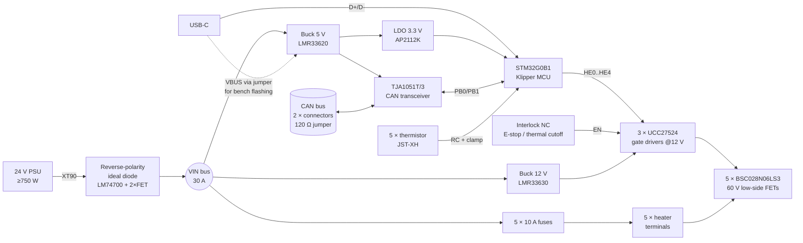

# HX5: 5-Zone Heater Expansion Board for Klipper

HX5 is an add-on Klipper MCU board for 3D printers. It has **five thermistor inputs and five
120 W heater outputs**. It connects to the Klipper host over **USB or CAN bus**, and it shows up as a
second `[mcu]`. It is meant for heated chambers, multi-zone beds, filament dryers, heated
build plates, and similar jobs where the main board has run out of heater channels.

> **Status:** design specification, rev A. This repo holds the electrical design (block-level
> schematic and netlist), the component selection, the calculations, the layout rules, the BOM and the
> Klipper firmware/config. The next step is schematic capture and PCB layout in KiCad
> (see [docs/pcb-layout.md](docs/pcb-layout.md)).

## Key specifications

| Parameter | Value |
|---|---|
| MCU | STM32G0B1CBT6 (Cortex-M0+, 64 MHz, 128 KB flash). Has both USB FS and FDCAN, and Klipper supports it directly |
| Host link | USB-C (USB 2.0 FS) **or** CAN 2.0 at 1 Mbit/s (TJA1051T/3). You choose one when you build the firmware |
| Supply voltage | **24 V nominal** (12–28 V operating range, 36 V absolute max) |
| Heater outputs | 5 × low-side N-MOSFET, gate-driven at 12 V, **120 W each at 24 V (5 A)** |
| Per-channel hardware rating | 10 A continuous (FET, traces, terminal), with a replaceable 10 A mini-blade fuse on each channel |
| Total board input | 30 A continuous (XT90 input) → 5 × 120 W = 600 W at 24 V with headroom |
| Thermistor inputs | 5 × 2-pin JST-XH, 4.7 kΩ 0.1 % pull-up. A jumper switches each one to 1 kΩ for PT1000 sensors |
| Input protection | Each input has a 10 kΩ series resistor, Schottky clamps and an RC filter. It survives a 24 V short |
| Extra I/O | 2 × PWM fan outputs (12 V or VIN, set by jumper), on-board NTC near the FETs, VIN voltage sense, status LED, AUX header |
| Safety | Hardware **heater interlock** input (normally closed: opening it disables all 5 gate drivers), drivers held off during reset, reverse-polarity ideal diode, input TVS |
| PCB | 4-layer, 2 oz outer copper, 120 × 80 mm, 4 × M3 mounting holes |

## Block diagram

## Repository layout

| Path | Contents |
|---|---|
| [docs/schematic.md](docs/schematic.md) | Sheet-by-sheet schematic: every part, every net, and the MCU pin map |
| [docs/calculations.md](docs/calculations.md) | Power budget, MOSFET/fuse/trace sizing, regulator design, thermistor front-end |
| [docs/pcb-layout.md](docs/pcb-layout.md) | Stack-up, current paths, placement and layout rules |
| [bom/HX5-BOM.csv](bom/HX5-BOM.csv) | Bill of materials with manufacturer part numbers |
| [firmware/README.md](firmware/README.md) | How to build and flash Klipper (USB or CAN) |
| [firmware/hx5.cfg](firmware/hx5.cfg) | Klipper config include for the board: 5 heaters, fans, monitoring, interlock |
| [orca-per-plate-printers/](orca-per-plate-printers/README.md) | OrcaSlicer patch: a different printer (and process) per build plate in one project |

## Connector summary

| Ref | Function | Type |
|---|---|---|
| J1 | Power in (24 V) | Amass XT90PW-M (40 A) |
| J2 | USB | USB-C receptacle (USB 2.0) |
| J3, J4 | CAN bus in/out (CANH, CANL, GND) | JST-XH 3-pin |
| J10–J14 | Heater 0–4 (VIN+, switched −) | Phoenix MSTBA 2,5/2-G-5,08 (12 A), pluggable |
| J20–J24 | Thermistor 0–4 | JST-XH 2-pin |
| J30, J31 | Fan 0/1 | JST-XH 2-pin |
| J5 | Heater interlock (NC loop) | JST-XH 2-pin, shipped with a shunt |
| J6 | SWD debug (3V3, SWDIO, SWCLK, NRST, GND) | 1×5 2.54 mm header |
| J7 | AUX (3V3, PA9, PA10, GND) | 1×4 2.54 mm header |

## Important notes for builders

1. **Design for 24 V.** 120 W at 24 V draws 5 A per channel, so all five channels together draw
   25 A. Each channel can carry 120 W at 12 V too (10 A), but the board input is limited to 30 A, so at
   12 V you can run **at most 3 channels at full 120 W at the same time**.
2. **Power supply.** Five heaters at 100 % draw 600 W. Use a 24 V supply of at least 750 W, such as a Mean Well
   RSP-750-24 or UHP-750-24. Ideally use a separate supply from the motion system. Klipper has no global power
   budget, so if your supply is smaller, use `max_power` in the config to limit each heater.
3. **Wire gauge.** Use 12 AWG (3.3 mm²) for the XT90 input and at least 18 AWG (0.8 mm²) for each heater.
4. **A MOSFET can fail shorted.** Firmware and the interlock cannot switch off a heater if its MOSFET has failed
   shorted. Fit a **thermal cutoff (thermal fuse or bimetal switch) on every heater element**. For chamber heaters,
   also wire the machine E-stop to a contactor that cuts this board's supply.
5. Use DC resistive heaters only. **This board does not switch mains (AC) heaters.** Use SSRs for those.
