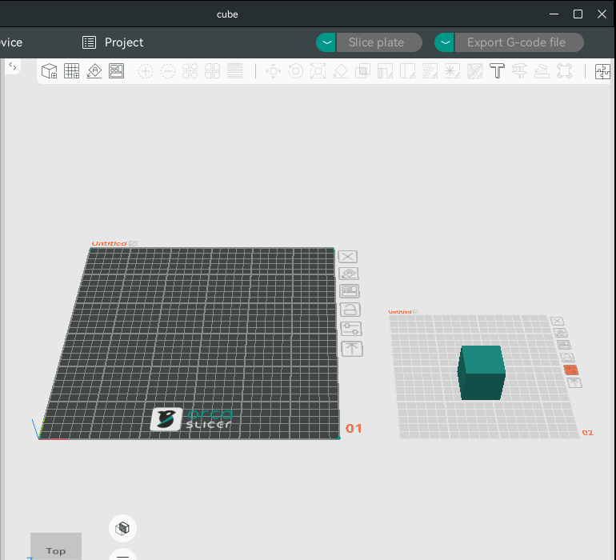
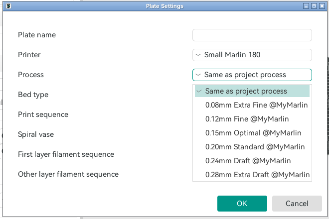
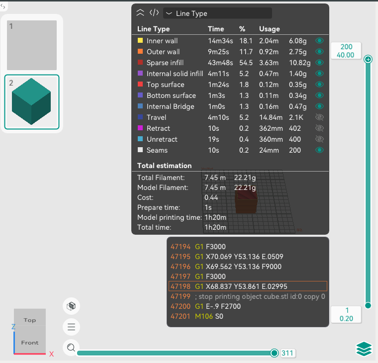

# OrcaSlicer: per-plate printers

This is a modification to [OrcaSlicer](https://github.com/OrcaSlicer/OrcaSlicer). It lets each
build plate in a project use a **different printer**, and optionally a different process
preset. One project can then hold a plate for a 256 × 256 mm printer next to a plate for a
180 × 180 mm one. Each plate is drawn with its own bed and sliced with its own printer's
settings: bed size, printable height, start/end G-code, firmware flavor and machine limits.

It ships as a patch against OrcaSlicer `main` at commit `808dd7d` (2026-11-25), which gives you a
forked build. See [Why not a plugin?](#why-not-a-plugin) for why it is not a plugin.



## Using it

1. Add a plate as usual (the "+" plate button).
2. Open the plate's **Plate Settings** (the gear icon on the plate).
3. Choose a **Printer**. The list holds every visible FFF printer preset that has as many
   extruders as the project's printer. "Same as project printer" removes the override.
4. You can also choose a **Process**. The list holds the process presets compatible with that
   printer. "Same as project process" keeps the sidebar's process.
5. Click OK. The plate takes the new printer's bed shape and size. The plate grid grows when it
   has to, so beds of different sizes never overlap, and objects move with their plates.



A plate with its own printer shows its gear icon as changed, and the tooltip names the printer.
"Slice plate", "Slice all" and "Export G-code" then produce G-code for each plate's own printer.

Filaments, flush volumes, filament colours and the other plate settings (bed type, print
sequence, spiral vase, ...) stay shared with the rest of the project.

### Saving

The plate's printer and process names are saved in the project `.3mf`, in the plate metadata
(`orca_printer_preset`, `orca_process_preset` in `Metadata/model_settings.config`). Unmodified
OrcaSlicer ignores these keys and slices every plate with the project's printer. Only the preset
*names* are saved. If you open the project on a machine that lacks a user preset a plate names,
slicing that plate fails with a "printer preset ... was not found" message, and you can pick
another printer in Plate Settings.

## Limitations

- **Same number of extruders.** A plate's printer must be an FFF printer with the same number of
  extruders as the project's printer. On multi-extruder printers it must also have the same
  extruder types. The filament list is shared by all plates and is sized for the project's
  printer. If the project's printer changes so that a plate's printer no longer matches, that
  plate reports an error when sliced.
- **"Arrange all"** uses the project's bed for every plate. To arrange a plate that has its own
  printer, use the arrange icon on that plate.
- **Drawing.** The 3D bed model, the axes, the printer logo and the bed-type texture belong to
  the project's printer. They are not drawn on a plate that has its own printer; that plate
  shows its own outline, grid and excluded areas.
- **Sending and printing** (device tab, physical printer, AMS mapping) still use the project's
  printer. Export each plate's G-code and send it to its printer.
- **The command line** (`orca-slicer --slice`) ignores per-plate printers and slices every plate
  with the project's presets.

## Building

```bash
./apply.sh                     # clones OrcaSlicer into ./OrcaSlicer and applies the patch
```

```bash
cd OrcaSlicer
```

Then build as usual. On Linux:

```bash
./build_linux.sh -u
```

```bash
./build_linux.sh -dsi
```

For Windows and macOS, see the OrcaSlicer wiki: `build_win.bat`, `build_release_macos.sh`.
To apply the patch to an existing clone instead, check out commit `808dd7d` and run
`git am patches/*.patch`. On a newer `main`, `git am -3` usually resolves small drift.

## How it works

The patch adds a full design note at `docs/HLSD/per-plate-printers.md`. In short:

- **`libslic3r/PlatePresetOverride.{hpp,cpp}`** (new) resolves a plate's printer/process preset
  names and overlays their settings onto the project's full config. The precedence matches
  `PresetBundle::full_fff_config()` (process < filament < printer < project). It checks that the
  printer is compatible (technology, extruder count, extruder variants).
- **`BackgroundSlicingProcess::apply()`** already layers each plate's own settings over the
  project config. The override is applied at that same point, so every slicing path (slice
  plate, slice all, export, send) picks it up. `validate()` reports a plate whose presets cannot
  be applied, and `Print::is_BBL_printer()` follows the plate's printer.
- **`PartPlate` / `PartPlateList`** store the override per plate, resolve each plate's bed
  (`PlateBed`) and give the plate that shape and height. The plate grid is sized to the extents
  of every bed. With no overrides the grid is identical to stock Orca. The override is part of
  undo/redo and of the 3MF.
- **Plate Settings dialog** adds the Printer and Process selectors.
- **Fit checks and single-plate arrange** use the plate's own bed and height.

Tests: `tests/libslic3r/test_plate_preset_override.cpp` covers the config overlay, precedence
and every failure case. `tests/libslic3r/test_3mf.cpp` checks that per-plate presets survive a
3MF round-trip, including names that contain XML special characters.

## What was verified

All of this was run on Ubuntu 24.04 against the patched tree:

- The full OrcaSlicer app, `libslic3r_tests` and `fff_print_tests` build.
- New tests pass: `[PlatePresetOverride]` in libslic3r (6 cases, including the 3MF round-trip)
  and in fff_print (a plate sliced with its own printer emits that printer's start G-code).
- The whole `libslic3r_tests` suite passes: 1888 passed, 10 skipped, 0 failed. One existing test
  writes a non-ASCII path and needs a UTF-8 locale, e.g. `LANG=C.UTF-8`.
- In the running app, a project used a 300 mm "Big Klipper" as its printer. Plate 2 was set to a
  180 mm "Small Marlin" with "0.20mm Standard @MyMarlin". Slicing plate 2 produced G-code with
  `printer_settings_id = Small Marlin 180`, that printer's start G-code, `printable_area =
  0x0,180x0,180x180,0x180` and the Marlin process. Saving and reopening the `.3mf` restored the
  plate's printer, its bed size and the object on it.



Not tested: Windows and macOS builds, and multi-extruder printers (the overlay is covered by unit
tests, but no H2D-style dual-nozzle project was sliced end to end).

## Why not a plugin?

Current OrcaSlicer `main` has a Python plugin system with Script, Slicing-pipeline, Pages,
Printer-agent and Resource-texture capabilities. It cannot do this feature:

- Plugins have no access to plates or their bed geometry. Every plate's bed shape comes from the
  single project printer, inside `PartPlateList`.
- The preset API (`orca.host.preset.printer.begin_update`) can only switch or edit the project's
  one printer. Switching it per plate would re-lay out every plate, prompt about unsaved changes,
  and slice "Slice all" with whichever printer happened to be active.
- `LifecycleEvent::PlateSelected` is declared but never fired, so a plugin cannot even follow the
  selected plate.

Per-plate beds and per-plate slicing configs have to live in the C++ core, so this is a fork
patch. It is kept small: about 600 lines of code in 16 files, plus tests and a design note.
Upstreaming it as a pull request is the way to avoid maintaining a fork.
